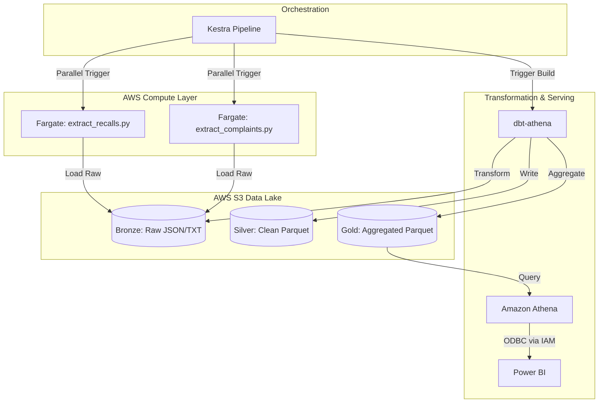

# 🚗 NHTSA Safety Data Lakehouse


## 📌 Executive Summary
The National Highway Traffic Safety Administration (NHTSA) receives millions of consumer vehicle complaints, but the lag between consumer reports and official manufacturer recalls can cost lives. 

This project is a fully automated, cloud-native data lakehouse engineered to ingest, transform, and analyze live NHTSA safety datasets. By calculating the ratio of complaints to official recalls across vehicle models, this architecture powers an early-warning system that flags high-risk vehicles statistically overdue for manufacturer intervention.

## 🏗️ Architecture & Data Flow



## ⚙️ Technical Implementation

### 1. Infrastructure as Code (Terraform)
* **Automated Provisioning:** AWS resources are defined, version-controlled, and deployed safely using Terraform.

### 2. Extraction (AWS Fargate & Docker)
* **Serverless Compute:** Python extraction scripts are containerized using Docker and pushed to Amazon ECR. Kestra triggers AWS Fargate tasks to run these containers in parallel.
* **Data Sources:** Ingests live Recall data (JSON API) and historical Complaint data (Flat TXT/ZIP) directly from the NHTSA database.

### 3. Orchestration (Kestra)
* **Declarative Workflows:** Managed via Kestra YAML configurations, scheduling automated daily runs.
* **Dependency Management:** Ensures the `dbt build` command only triggers after both Fargate ingestion tasks successfully complete and land data in the Bronze layer.

### 4. Transformation (dbt & Amazon Athena)
Implemented a strict **Medallion Data Architecture**:
* **Bronze Layer:** Raw, untyped data stored in Amazon S3.
* **Silver Layer:** dbt models normalize column names, cast data types, handle nulls, and deduplicate records. Stored as optimized Parquet files.
* **Gold Layer:** A highly aggregated analytics table (`gold_safety_analytics`). This layer calculates the `High_Unaddressed_Risk_Flag` and `Industry_Avg_Complaints_Per_Recall` metrics, pushing heavy computations to the cloud rather than the BI tool.

### 5. BI & Analytics (Power BI)
* **Direct Cloud Connection:** Connected via the Simba Amazon Athena ODBC driver using IAM credentials.
* **Actionable Intelligence:** Features a predictive heatmap identifying specific component failures (e.g., Engine, Forward Collision Avoidance) across major automakers.

## 📂 Repository Structure
```text
├── terraform-scripts/       # Infrastructure as Code provisioning
│   ├── main.tf
│   └── variables.tf
├── dbt/
│   ├── models/
│   │   ├── bronze/          # Source configurations
│   │   ├── silver/          # Cleaning and standardizing models
│   │   └── gold/            # Final analytics tables
│   ├── dbt_project.yml
│   └── profiles.yml
├── extraction/
│   ├── extract_recalls.py   # Python script for NHTSA API
│   ├── extract_complaints.py# Python script for NHTSA ZIP files
│   ├── requirements.txt
│   └── Dockerfile           # Container build instructions
├── kestra/
│   └── nhtsa_pipeline.yml   # DAG orchestration configuration
├── dashboard/
│   └── dashboard_preview.png# Screenshots of the Power BI report
├── .gitignore
└── README.md
```

## 🚀 How to Run Locally

### Prerequisites
* AWS Account with S3, Athena, and ECR access.
* Local AWS CLI configured with active IAM credentials.
* Docker Desktop installed.
* Terraform installed.

### Setup Instructions
1. **Clone the repository:**
   ```bash
   git clone https://github.com/SaketShah/nhtsa-safety-data-lakehouse.git
   cd nhtsa-safety-data-lakehouse
   ```
2. **Provision Infrastructure:**
   ```bash
   cd terraform-scripts
   terraform init
   terraform apply
   ```
3. **Build and push the Docker image to AWS ECR:**
   ```bash
   cd ../extraction
   docker build -t nhtsa-ingestion .
   docker tag nhtsa-ingestion:latest <your-account-id>.dkr.ecr.<region>.amazonaws.com/nhtsa-ingestion:latest
   docker push <your-account-id>.dkr.ecr.<region>.amazonaws.com/nhtsa-ingestion:latest
   ```
4. **Deploy the Orchestration:**
   Import `kestra/nhtsa_pipeline.yml` into your Kestra instance and update the S3 bucket names and ECR image URIs to match your environment.
5. **Connect Power BI:**
   Install the Amazon Athena ODBC driver, configure the DSN with your AWS Access Keys, and query the `gold_safety_analytics` table.
